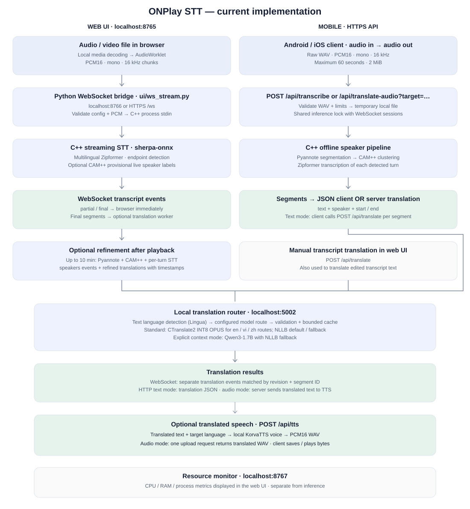

# ONPlay STT — C++ streaming lab

Inference offline bằng C++20 + sherpa-onnx 2.0.1, dùng model Zipformer multilingual INT8.

## Speech processing flow

Current implementation: streaming browser recognition and a separate mobile WAV API.



The browser decodes audio/video locally and sends PCM chunks to the C++ engine
through the Python WebSocket bridge. Partial/final transcripts return immediately;
optional translation runs on a separate worker. Optional CAM++ live speaker labels
are provisional. After playback, recordings up to 10 minutes can be refined with
Pyannote segmentation, CAM++ clustering and per-turn STT; refined translations
are sent separately with segment IDs and timestamps.

The mobile API accepts PCM16 mono 16 kHz WAV (up to 60 seconds and 2 MiB), runs
offline diarization and per-turn STT, and returns speaker/timestamp segments.
For text results, clients can call `/api/translate` sequentially for those segments.
For audio output, `/api/translate-audio?target=vi` performs recognition, translation
and speech synthesis in one request and returns WAV bytes.
Language detection operates on text in the translation router, not on STT audio.
The WebSocket and WAV upload paths share one inference lock.
See [the mobile API guide](docs/translation-api.md) for the current contract.

## Chạy giao diện trên Mac Apple Silicon

```sh
./scripts/setup.sh
./scripts/build.sh
./scripts/ui.sh
```

Mở http://127.0.0.1:8765, chọn hoặc thả audio/MP4 vào để tự bắt đầu nhận dạng. Cần Xcode Command Line Tools, Python 3 và mạng cho lần tải dependency/model đầu tiên. `ui.sh` cài `websockets==15.0.1` vào `.venv` nếu thiếu.

### File lớn bắt đầu như thế nào?

Trình duyệt đọc file gốc qua Blob và giải mã audio tăng dần, AudioWorklet chuyển thành PCM16 mono 16 kHz rồi gửi từng chunk nhỏ qua WebSocket loopback. Core C++ đọc stdin, giữ encoder state và trả partial ngay khi có. Không upload cả MP4, không chờ giải mã xong video. The optional speaker pass temporarily saves decoded PCM locally; streaming STT remains unlimited, while the speaker preview is limited to 10 minutes.

Chỉ cần thời gian mở metadata/codec của file và nạp model (mẫu trên Mac khoảng 1,3 giây). Khả năng mở MP4 tùy codec được trình duyệt hỗ trợ. Đã thử một MP4 kiểm thử 1.800.000.000 byte có audio ngắn và free-space padding: mở, phát và nhận dạng được mà không upload. Đây chưa phải benchmark video dài thực tế.

- Partial hiển thị ngay trong ô chính và có thể được model sửa lại; chỉ nối các đoạn final.
- Phổ trực tiếp được dựng từ chính các chunk đang phát, cửa sổ khoảng 60 giây với chunk 100 ms. File nhỏ còn có phổ tổng quan trước khi chạy; file lớn không được giải mã toàn bộ vào RAM trình duyệt.
- Chỉnh CPU threads và nhịp chunk trước khi chạy. Nhịp chunk đầu vào không thay chunk nội bộ đã export trong model.
- Bỏ chọn **Nghe âm thanh khi nhận dạng** chỉ tắt tiếng loa qua GainNode, vẫn nhận dạng PCM bình thường.
- **Dừng nhận dạng** hủy socket/engine và giữ chữ đã có. Tạm dừng player sẽ tạm dừng cấp PCM.
- Tải hoặc sao chép bản chép lời sau khi hoàn tất.

HTTP chỉ phục vụ giao diện trên 127.0.0.1:8765, WebSocket trên 127.0.0.1:8766 có kiểm tra Origin. The mobile WAV upload API is documented below. Một phiên inference mỗi lúc.

## CLI và core

```sh
./scripts/run.sh models/vi.wav
./scripts/run.sh models/vi.wav --realtime --threads=2 --chunk-ms=100
```

CLI đọc WAV mono PCM16 16 kHz tăng dần, hỗ trợ PCM thường và WAVE_FORMAT_EXTENSIBLE PCM16. Dùng `-` thay tên WAV để nhận raw PCM16 little endian 16 kHz từ stdin. CLI mặc định chạy nhanh nhất; `--realtime` chỉ dành cho benchmark file WAV theo thời gian thực. Giao diện dùng nhịp phát audio của trình duyệt.

- `include/onplay/stt.hpp`: C++ API `acceptAudio()` / `finish()`, callback transcript.
- `include/onplay/wave_reader.hpp`: đọc WAV theo chunk, không giữ toàn bộ file trong RAM.
- `src/stt.cpp`: RAII model/stream, incremental decode, endpoint/reset, flush cuối phiên.
- `src/main.cpp`: CLI WAV/stdin, partial/final, progress và benchmark.
- `ui/live.mjs`, `ui/pcm-worklet.js`: native media decoding → PCM chunks.
- `ui/ws_stream.py`: bounded PCM bridge đến C++, dừng process khi ngắt kết nối.

Core nhận float PCM mono 16 kHz trong [-1,1], tối đa một giây mỗi lần gọi. Chỉ gọi từ một worker thread; callback đồng bộ, không re-enter engine hoặc gọi inference trên UI/audio callback. `finish()` idempotent, sau đó tạo session mới.

CMake với SDK sherpa-onnx của nền tảng có `include/` và `lib/`:

```sh
cmake -S . -B build/cmake -DCMAKE_BUILD_TYPE=Release -DSHERPA_ONNX_ROOT=/absolute/path/to/sherpa-sdk
cmake --build build/cmake
```

CMake chưa kiểm tra trên máy này vì chưa cài; build clang++ đã qua. Chưa có AAR/XCFramework, micro, training pipeline, LID trả mã ngôn ngữ or live speaker labels. Offline speaker diarization is available as an experimental UI option.

## Kiểm tra

```sh
./scripts/test.sh
python3 tests/wave_reader.py
node tests/spectrum.mjs
# Khi UI server đang chạy, không có phiên khác:
.venv/bin/python tests/live_stream.py
.venv/bin/python tests/ui_smoke.py
```

Test gồm inference thật Anh/Việt và chuyển giữa hai câu, lifecycle/silence/PCM validation với ASan/UBSan cho code dự án, WAV lớn/truncated, FFT và streaming qua stdin/socket. Test socket xác minh nhận partial khi nguồn PCM vẫn mở, trước end-of-stream. Chưa đo WER/CER, RAM/pin/nhiệt trên Android/iOS hoặc video dài.

## Model và nguồn

Model `sherpa-onnx-streaming-zipformer-ar_en_id_ja_ru_th_vi_zh-2025-02-10` hỗ trợ Arabic, English, Indonesian, Japanese, Russian, Thai, Vietnamese, Chinese; chưa có tiếng Hàn. Tự giải mã không cần chọn ngôn ngữ, chưa trả language/confidence; the optional diarization pass adds session-local speaker labels. Chưa đánh giá đổi ngôn ngữ giữa câu hoặc nói chồng lấn.

- [sherpa-onnx runtime/C API](https://github.com/k2-fsa/sherpa-onnx/tree/v2.0.1)
- [Model/WAV release](https://github.com/k2-fsa/sherpa-onnx/releases/tag/asr-models)
- [PengChengStarling](https://github.com/yangb05/PengChengStarling)

Trọng số và runtime là thành phần bên thứ ba; giữ các license đi kèm khi phân phối SDK.

## Experimental speaker diarization

```sh
./scripts/setup-speakers.sh
./scripts/build.sh
./scripts/ui.sh
# In another terminal, with websockets installed in .venv:
.venv/bin/python tests/speakers.py
```

Enable **Phân biệt người nói** before starting. Streaming partials and finals now
include provisional session-local speaker labels. The CAM++ embedding model
compares the most recent four seconds, refreshing after roughly two seconds of
audio with changing recognized text. Until enough audio is available, the UI
shows that it is still identifying the speaker. This bounded live path also runs
on recordings longer than 10 minutes. Its labels are approximate: one ASR
utterance may contain multiple voices, and rapid or overlapping turns can be
misassigned. The bridge checks the pinned embedding checksum before enabling it.
After playback ends, `onplay-speakers` runs local offline segmentation and speaker
clustering, then transcribes each detected turn with the existing STT model.
The result includes timestamps and session-local labels such as `Người 1`.
Expand **Bản chữ gốc** to compare against the first streaming transcript; neither
pass is guaranteed to have better word accuracy. Copy/download uses the displayed
speaker transcript. The processing time and RTF include the extra pass.

This preview saves mono PCM16 at 16 kHz in a temporary local WAV, deleted on
completion, cancellation or handled failure. It never uploads the original file.
The offline pass loads audio into RAM and is capped at 10 minutes (about 19.2 MB
of temporary PCM plus model and inference memory). Longer recordings skip only the offline pass and retain live labels. Missing or
invalid embedding models fall back to ordinary text with a warning. Failed
offline diarization retains the streaming transcript.
Stopping during the extra pass preserves the original text. Labels do not identify
real names and reset every run. Short turns, noise and simultaneous voices can
produce incorrect labels or words; overlapping turns can transcribe mixed voices.

Model assets remain ignored under `models/speakers/`. The setup script pins SHA256:

| Asset | SHA256 | Upstream license |
|---|---|---|
| [Pyannote segmentation 3.0 archive](https://github.com/k2-fsa/sherpa-onnx/releases/download/speaker-segmentation-models/sherpa-onnx-pyannote-segmentation-3-0.tar.bz2) | `24615ee884c897d9d2ba09bb4d30da6bb1b15e685065962db5b02e76e4996488` | MIT, included in archive |
| [3D-Speaker CAM++ embedding](https://github.com/k2-fsa/sherpa-onnx/releases/download/speaker-recongition-models/3dspeaker_speech_campplus_sv_zh-cn_16k-common.onnx) | `f682b514c05d947ee3fa91cd6ec6c5c7543479a128373fa29b1faedccd21fd11` | [Apache-2.0 project license](https://github.com/modelscope/3D-Speaker/blob/main/LICENSE) |

CLI live labels: `./scripts/run.sh models/vi.wav --speaker-model=models/speakers/embedding.onnx`.
The optional `ModelConfig.speaker_model` enables this path; `Transcript.speaker`
is zero when unknown/disabled, otherwise a provisional positive label. Existing
CLI output is unchanged unless `--speaker-model` is supplied.

The runtime uses the archive's `model.int8.onnx` segmentation file and CAM++ with
CPU inference, automatic speaker count and clustering threshold 0.5. Tests use
real model inference on Vietnamese/English/Vietnamese samples, check two distinct
labels and label reuse, silence, disabled mode, missing assets, duration fallback
and cancellation. These synthetic checks are not a diarization error-rate or
Vietnamese conversation benchmark.

## Hiệu năng trên cùng trang STT

Trang chính có bảng CPU, RAM máy, RAM RSS engine C++ và lưu trữ, tự cập nhật mỗi 2 giây. Mở **Chi tiết tiến trình, biểu đồ và dung lượng model** để xem CPU/RAM từng tiến trình, đỉnh RSS quan sát, luồng OS, CPU time, swap và I/O đĩa. Monitor dùng `psutil==7.2.2`, phục vụ ở loopback 8767 và được nhúng vào trang 8765. `ui/server.py` tự khởi động monitor nếu cổng này chưa được dùng; có thể chạy riêng bằng `.venv/bin/python ui/metrics.py` để theo dõi mà không ngắt session đang chạy.

CPU tiến trình 100% tương đương một lõi; CPU toàn máy chuẩn hóa trên tất cả lõi. CPU/RAM trình duyệt chưa được tách riêng; chưa đo GPU, nhiệt độ hoặc điện năng. Kiểm tra số đo/API: `.venv/bin/python tests/metrics.py`.


## HTTPS streaming origin

When serving the UI through the existing `stt.qiverse.top` tunnel, start or
restart the server with the public browser origin explicitly allowed:

```sh
ONPLAY_PUBLIC_ORIGIN=https://stt.qiverse.top ./scripts/ui.sh
```

Keep this environment variable on every restart. Without it, local HTTP still
works, but browser WebSocket connections from the HTTPS site are rejected.
The HTTPS tunnel must route `/ws` to `127.0.0.1:8766`; other UI/API paths use
`127.0.0.1:8765`. Additional allowed origins can be comma-separated; do not use
an unrestricted origin policy.

## Mobile HTTPS POST API

`POST https://stt.qiverse.top/api/transcribe` accepts a raw WAV body with
`Content-Type: audio/wav` and `Content-Length`. Use PCM signed 16-bit
little-endian, mono, 16 kHz, up to 60 seconds and 2 MiB. Multipart, compressed
audio and chunked transfer encoding are unsupported.

```sh
curl --fail-with-body https://stt.qiverse.top/api/transcribe \
  -H 'Content-Type: audio/wav' --data-binary @audio.wav
```

Success: `{"type":"speakers","segments":[{"start":0.5,"end":2.8,"speaker":0,"text":"recognized transcript"}]}`.
Times are seconds from the start of the audio; speaker IDs start at zero and
are local to each request. Silence returns an empty `segments` array. Errors return `{"error":"..."}`:
400 invalid length/framing, 408 upload timeout, 409 engine busy, 413 size limit,
415 content type, 422 invalid WAV/format/duration, 500 engine failure,
503 missing/invalid speaker models, 504 inference timeout (90 seconds). Only one inference runs at a time, shared
with WebSocket sessions. Uploads use temporary files deleted after processing.
This endpoint currently has no authentication. The browser UI still streams PCM.

## Audio in → translated audio out

Send the source WAV and target language in one request:

```sh
curl --fail-with-body 'http://127.0.0.1:8765/api/translate-audio?target=en' \
  -H 'Content-Type: audio/wav' \
  --data-binary @models/vi.wav \
  --output translated-en.wav
```

The server reuses a resident STT model with a fresh recognition stream per request,
then translates the transcript and synthesizes one WAV in the target language.
This route skips speaker segmentation; `/api/transcribe` still returns speaker segments.
The client only uploads audio and saves/plays the response.
Input: PCM16 mono 16 kHz WAV, up to
60 seconds / 2 MiB. Output: PCM16 mono 44,100 Hz WAV, using KorvaTTS locally.
Silence returns HTTP 204 without audio. Source speaker voices, pauses
and timing are not reproduced. Translation output over 3,000 characters returns
422; send shorter audio. Start the translation router (`./scripts/translation.sh`)
and restart the UI/API server (`./scripts/ui.sh`) before use.
The server warms the STT and KorvaTTS models at startup; KorvaTTS assets download
on first run and are cached locally.
`Server-Timing` reports `stt`,
`translate` and `tts` durations in milliseconds on successful requests.
These timings exclude upload and download. The first TTS request can be slower;
subsecond processing is not guaranteed for every clip or translation pair.

See [the one-request API contract](docs/translation-api.md#audio-to-translated-audio)
for limits and errors. `.venv/bin/python tests/audio_translation.py` checks the
HTTP composition and failures using stubbed inference/translation/synthesis.
`.venv/bin/python tests/recognition.py` checks real-model worker reuse, isolated
streams, invalid framing, timeout cleanup and recovery after worker failure.

## Translated speech audio

After translation, click **Tạo audio bản dịch** to generate server-side speech,
then use the audio player or **Tải audio .wav**. Enable **Nghe âm thanh khi dịch** beside the original-audio toggle to generate
and play each new live translation sequentially. It is off by default. Refined
translations at the end of playback are displayed without repeating speech.
Unchecking the option, stopping, changing the target or starting again cancels
queued audio. Manual transcript translation is also read when enabled.
The queue holds at most 32 segments; failures or overflow stop automatic speech
and keep the translated text. Browser autoplay restrictions may require manual
playback. Original audio and translated speech have independent toggles.

`POST /api/tts` accepts `{"text":"Hello","language":"en"}` and returns
`audio/wav` (mono PCM16, 44,100 Hz). Send the translated text and its target
language. The backend uses KorvaTTS locally with the `khanh_vy` voice for
Vietnamese and English. KorvaTTS weights are downloaded on first use and cached
locally; English quality is not guaranteed to match Vietnamese. It does not
preserve the original speaker's voice or timing. Other target languages can be
translated, but speech synthesis currently supports only Vietnamese and English.

Requests are limited to 3,000 characters and 32 KiB JSON, with one synthesis at a
time. No persistent audio URL is created. See [the API guide](docs/translation-api.md#translated-speech-audio)
for client integration. Run `.venv/bin/python tests/tts.py` for HTTP/validation
checks; set `ONPLAY_TEST_REAL_TTS=1` to also generate real Vietnamese/English WAVs.

## Low-latency live translation

WebSocket sessions with a translation target enable `--low-latency` on the
streaming recognizer: finalize after approximately six seconds of utterance audio,
or 0.7 seconds of trailing silence after speech. Recognition-only sessions keep
the existing 20-second / 1.2-second settings. Short final segments are sent to the
translation worker immediately. The model's decoding/lookahead, translation,
network, synthesis and playback queue add latency; these thresholds are not an
end-to-end latency guarantee. The six-second limit can still split sentence
context and reduce recognition/translation quality. No partial hypotheses are spoken.

## Transcript translation

The UI offers a target-language selector (translation is off by default), a
separate translation panel, and copy/download actions. When a target is selected,
the browser sends `target_language` in the initial WebSocket configuration.
The server sends original `final` events immediately and translates their text
on a separate worker, then sends `translation` events over the same socket.
Recognition continues while translation is pending; partial hypotheses are not
translated. No HTTP translation requests are made during live recognition.
Speaker refinement sends a new `speakers` list followed by its translations.
The manual **Dịch bản chữ hiện tại** action still uses `/api/translate` to
translate edited text. Original text and completed translations remain available
on a translation failure. Stopping closes the socket and discards queued work;
an already running provider request can take up to its 60-second timeout to end.
Each translation accepts up to 10,000 characters.

WebSocket translation is optional: omit `target_language` or send `""` for
recognition only. Example initial configuration:

```json
{"threads":2,"chunk":100,"speakers":true,"target_language":"vi"}
```

Each streaming `final` has an integer `id` starting at zero. A translation event
contains `type: "translation"`, the same `id`, `revision: "live"`,
`source: {"text": "…"}` and `translation: {"text": "…", "language": "vi"}`.
A refined `speakers` list has its own zero-based segment IDs; translations use
`revision: "refined"`. Consumers must match both revision and ID, and ignore late
live translations after refinement. Speaker labels are included when available;
`start`/`end` are included for refined segments, not invented for streaming finals.
Existing WebSocket speaker labels start at 1; the POST API remains unchanged.
`translation_error` reports provider errors or a full queue (64 pending segments);
recognition continues and translation stops for that session. `done` is sent after
pending translations finish or are skipped following an error. Translation time
is not included in STT processing metrics. Configured provider languages still
control which targets work.

### Local translation router

The default translation endpoint is the local router at `127.0.0.1:5002`.
It normalizes NFC Unicode/whitespace while preserving line boundaries, resolves
source metadata (or detects language using Lingua), selects a configured model,
validates output/placeholders, and keeps a bounded in-memory LRU cache.
The router supports the twelve ISO 639-1 languages offered by the UI, rather than
exposing every language the underlying NLLB model supports.

`config/translation.yaml` now defaults to native INT8 CTranslate2 NLLB.
The six directed pairs among English, Vietnamese and Chinese route to native
INT8 OPUS (`opus-fast`), using English as a pivot when needed, with `nllb-fast`
as fallback. These are latency-oriented routes over existing model weights,
not claims that OPUS won a semantic quality benchmark. Qwen3-1.7B remains an
explicit slow context mode and falls back to native NLLB.

The browser's live recognition always requests `standard` mode. The context-mode
selector applies only to manually translating the transcript again. This keeps
Qwen outside the live translation path; Qwen cannot meet the 500 ms target on
this setup.

Install and prepare the isolated Python 3.12 runtime and local model assets:

```sh
python3.12 -m venv .deps/translation-venv
.deps/translation-venv/bin/python -m pip install -r ui/translation-requirements.txt
.deps/translation-venv/bin/python scripts/setup-translation.py
.deps/translation-venv/bin/python scripts/setup-fast-translation.py
.deps/translation-venv/bin/ct2-transformers-converter --model models/translation/nllb-200 --output_dir models/translation/nllb-200-ct2 --quantization int8
```

Run conversion once for a new output directory. OPUS setup verifies the installed
weight SHA-256 against the recorded upstream model hashes. Assets stay under
ignored `models/` and `.deps/` paths. Native inference does not require Docker.
The old `compose.translation.yaml` service remains optional for experiments;
it is not used by the active fast routes.

Start the router in one terminal, then the STT UI in another:

```sh
./scripts/translation.sh
# Another terminal:
./scripts/ui.sh
```

The router preloads and warms native models and language detection before opening
port 5002, so first-use loading is outside audio processing. Fast inference uses
CPU INT8 with two threads and greedy decoding. Qwen is loaded lazily only for
explicit context requests, using Apple MPS when available. The model/tokenizer
worker is serialized; concurrent router requests return 409 instead of accumulating
an unbounded queue. Native outputs must end normally; truncation is rejected.

`POST /api/translate` keeps the `text` response and adds source/target, model,
latency, fallback/cache and `within_budget` metadata. Source/target use twelve
ISO 639-1 codes; the STT audio model still has its original language coverage.
See [the HTTPS mobile guide](docs/translation-api.md) for requests, limits,
Android/iOS configuration and segment-preserving client composition. The original
`POST /api/transcribe` contract is unchanged.

NFC/whitespace normalization preserves line boundaries. Literal placeholders are
held outside inference and stitched back into translated fragments; this may
reduce context around a placeholder. The cache is a bounded in-memory LRU and
includes context and route identity. Context contains at most five previous source
segments. No transcript text is included in aggregate metrics or router logs.

`GET http://127.0.0.1:5002/metrics` reports requests, cache hits, errors, fallback,
model usage, placeholder failures and requests over 500 ms. The client still has
a 60-second transport timeout, which is not a processing-latency promise. A native
generation can continue after its client times out. The local latency check is:

```sh
.venv/bin/python tests/translation_latency.py
```

The 2026-11-02 run measured 25 uncached HTTP requests: p50 53.56 ms, p95 283.94 ms,
maximum 377.64 ms. This is coverage of the benchmark inputs, not a hard upper bound
for arbitrary text, host contention or mobile network latency. Long segments can
exceed 500 ms; `within_budget` reports the actual result rather than hiding it.
Quality still requires a separate representative human-reviewed evaluation.

**Model limitations:** NLLB uses CC-BY-NC-4.0 and its model card limits intended
use to research, excluding production deployment. This default is for local
experiments, not a production/mobile release recommendation. Qwen3-1.7B is
Apache-2.0 and is an experimental small context model, not a proven improvement.
See [API/socket examples](docs/translation-api.md), [model records](docs/translation-models.md) and the
[NLLB model card](https://huggingface.co/facebook/nllb-200-distilled-600M).

Run the HTTP integration checks with a local fake translation provider:

```sh
.venv/bin/python tests/translation_engine.py
.venv/bin/python tests/translation.py
.venv/bin/python tests/socket_translation.py
node tests/translation_ui.mjs
```

These checks validate the API contract and failures, not translation quality.

Segment speech over the existing WebSocket bridge is opt-in with `speech: true`.
See [the mobile streaming protocol](docs/streaming-audio.md) for PCM input,
per-segment WAV events, playback ordering and limits.
